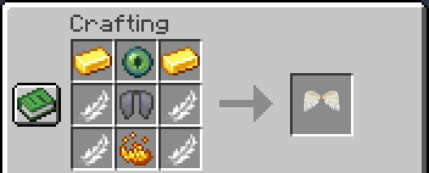
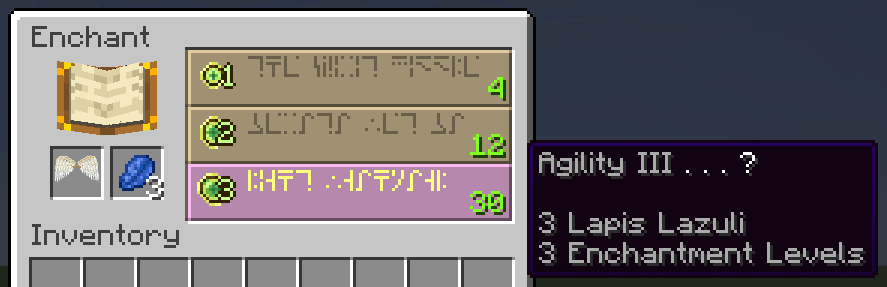

# Angel Wings · Java Edition 26.3

## Installation

On Java Edition 26.3, close the world or stop the server before installing. Move older Angel Wings datapack ZIPs out of the world's `datapacks` folder, put the [v11 datapack](AngelWings.v11_mc_26.3.zip) there, then reopen the world or start the server. The first startup registers Agility and Wingbeat. After that, you can use `/reload`.

Put the [resource pack](AngelWings_RP_26.3.zip) in your client's `resourcepacks` folder and enable it above older Angel Wings packs. Keep both ZIPs intact.

## Craft the wings

| Left | Center | Right |
| --- | --- | --- |
| Gold ingot | Eye of Ender | Gold ingot |
| Feather | Elytra | Feather |
| Feather | Blaze powder | Feather |

## Enchant the wings with Agility

Put unenchanted Angel Wings in an enchanting table with lapis lazuli. Agility has three levels. For the level-30 offer, place 15 ordinary bookshelves around the table with a one-block air gap, reach experience level 30, and bring three lapis.

Hover over the offers to read the enchantment clue. When the third offer shows **Agility III**, select it. This spends three lapis and three experience levels. If you want a fresh set of offers, enchant another item or a book first.

In this roll, the wings also received Unbreaking III. [View the enchanted wings](Screenshots/agility-result.png).
