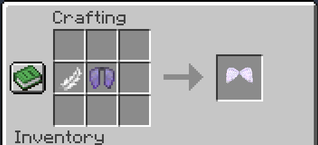

# Angel Wings · Java Edition 26.3

## Installation

On Java Edition 26.3, close the world or stop the server before installing. Move older Angel Wings datapack ZIPs out of the world's `datapacks` folder, put the [v12 datapack](AngelWings.v12_mc_26.3.zip) there, then reopen the world or start the server. The first startup registers Agility and Wingbeat. After that, you can use `/reload`.

Put the [resource pack](AngelWings_RP_26.3.zip) in your client's `resourcepacks` folder and enable it above older Angel Wings packs. Keep both ZIPs intact.

## Craft the wings

First craft **Wing Fittings** in a crafting table. Leave the center empty.

| Left | Center | Right |
| --- | --- | --- |
| Gold ingot | Eye of Ender | Gold ingot |
| Feather | Empty | Feather |
| Feather | Blaze powder | Feather |

Next, place the fittings and one elytra anywhere in the crafting grid. The finished wings keep the elytra’s enchantments and current damage.

## Combine or separate a chestplate

Drop one pair of Angel Wings and one chestplate together on top of the same anvil. When the anvil rings, pick up the wings. They keep their feathered appearance and flight controls, and gain the chestplate’s armor, toughness, knockback resistance, and enchantments. If both items have the same enchantment, the higher level wins. Damage from combat wears the combined wings. Netherite also protects the dropped wings from fire and lava.

Drop the combined wings on top of a grindstone to separate them. The chestplate returns with its original enchantments and condition. The wings recover their original enchantments and keep new enchantments or higher levels added after combining.

## Enchant the wings with Agility

Put unenchanted Angel Wings in an enchanting table with lapis lazuli. Agility has three levels. For the level-30 offer, place 15 ordinary bookshelves around the table with a one-block air gap, reach experience level 30, and bring three lapis.

Hover over the offers to read the enchantment clue. When the third offer shows **Agility III**, select it. This spends three lapis and three experience levels. If you want a fresh set of offers, enchant another item or a book first.

In this roll, the wings also received Unbreaking III. [View the enchanted wings](Screenshots/agility-result.png).
